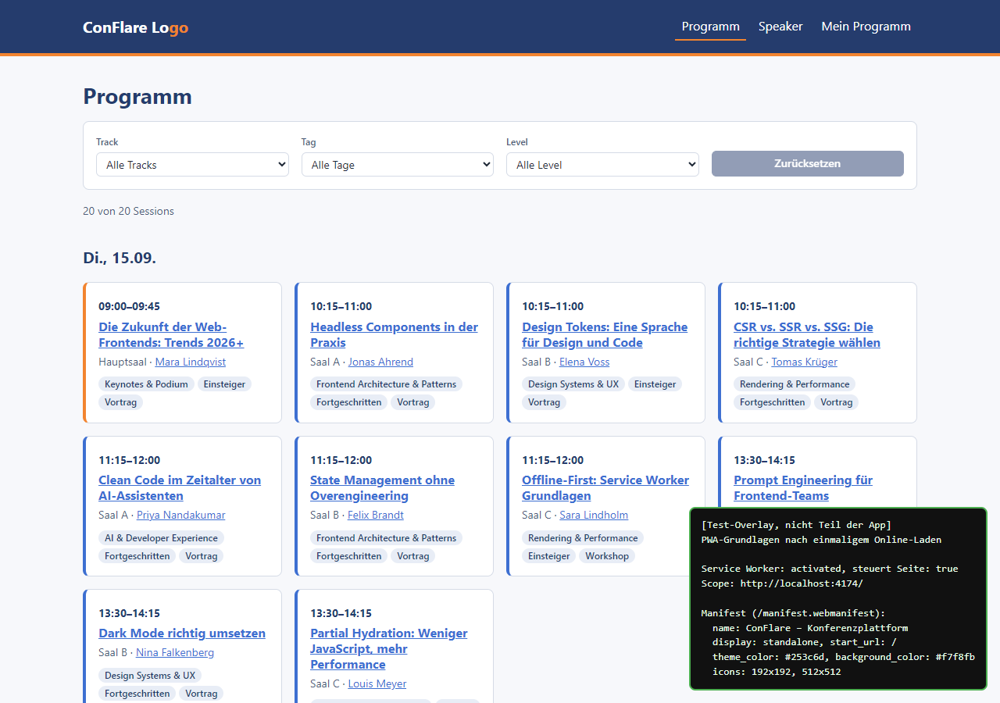
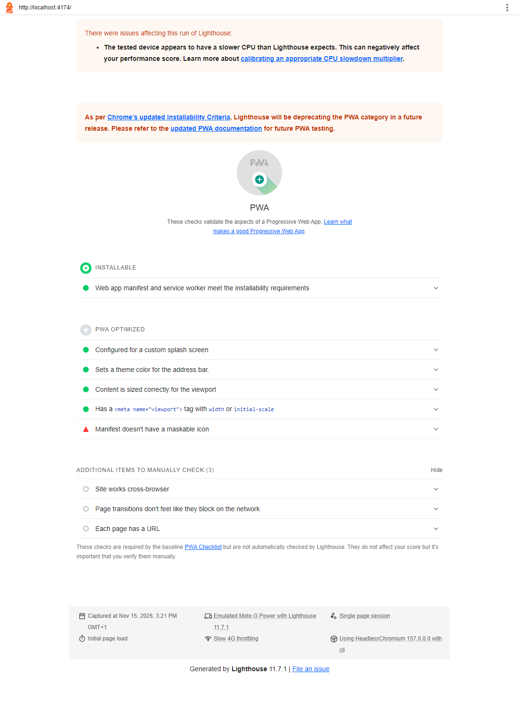
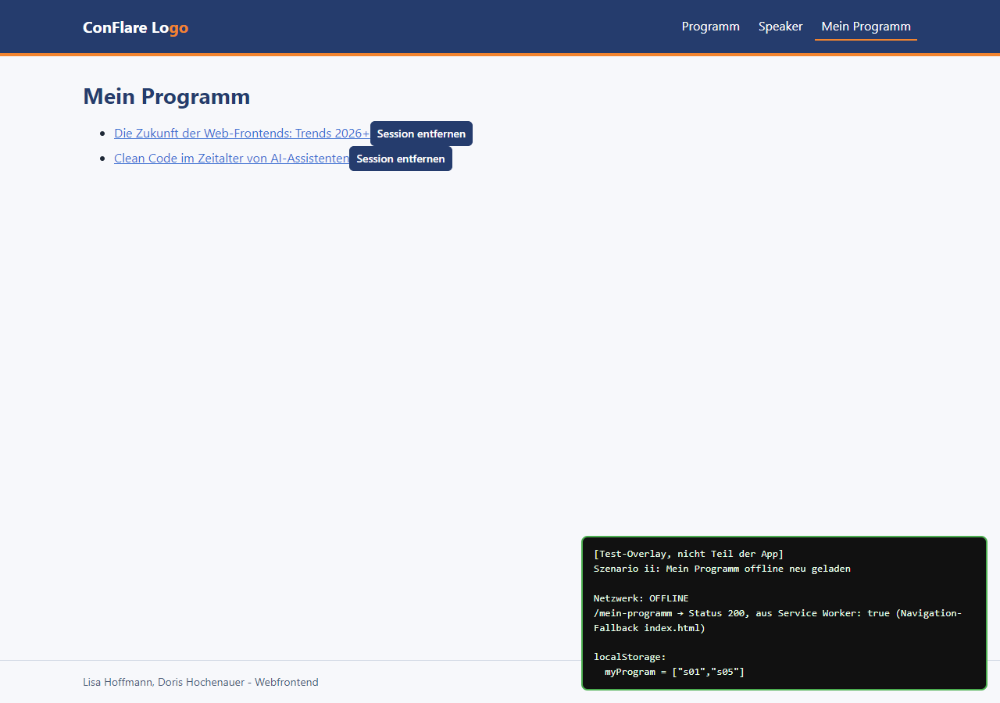
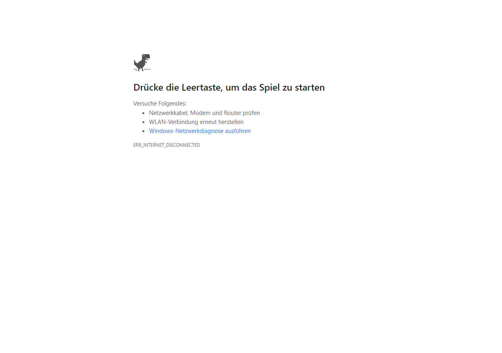

# Verifikations-Nachweis

## Vorgehen

- **Build:** `npm run build` + `vite preview` (Port 4174), da der Service Worker nur im Produktions-Build aktiv ist.
- **Browser:** Chrome 157 (headless), Windows 11.
- **Offline:** über das Chrome DevTools Protocol (`setOfflineMode`), technisch dasselbe wie DevTools → Network → „Offline".
- **Ablauf:** automatisiert mit Puppeteer, jedes Szenario in einem eigenen, leeren Browser-Kontext (wie Inkognito). Skript: [`assets/offline-test.mjs`](assets/offline-test.mjs), Rohdaten: [`assets/results.json`](assets/results.json).
- **PWA-Audit:** Lighthouse 11.7.1 (letzte Version mit PWA-Kategorie), Report: [`assets/06-lighthouse-pwa-report.html`](assets/06-lighthouse-pwa-report.html).

Die grün umrandete Box in den Screenshots ist ein Test-Overlay mit den gemessenen Werten, nicht Teil der App.

## PWA-Grundlagen (Teil A)

Service Worker aktiv und steuert die Seite, Manifest mit Name, `display: standalone`, `start_url`, Farben aus den Tokens und Icons in 192 und 512 px.

Lighthouse: **Installable ✅**, Splash-Screen ✅, Theme-Color ✅, Viewport ✅, maskable Icon ❌.

## Szenario i: Session-Übersicht offline

Nach einmaligem Online-Laden liegen das App-Grundgerüst im Precache und die Programmdaten im Cache `conference-data`. Die JSON ist nicht im Precache (ADR-0006).

Offline neu geladen: `/` und `conference-data.json` kommen mit Status 200 aus dem Service Worker, alle 20 Sessions sichtbar, Track-Filter funktioniert (4 Sessions).

## Szenario ii: „Mein Programm" offline

Online Sessions s01 und s05 gemerkt, dann offline `/mein-programm` direkt neu geladen. Die Seite kommt über den Navigation-Fallback aus dem Service Worker, beide Sessions werden angezeigt. Offline „Session entfernen" funktioniert ebenfalls (localStorage danach `["s05"]`).

## Szenario iii: Erstbesuch offline

Leerer Browser-Kontext, zuerst offline, dann App aufgerufen: Fehlerseite des Browsers (`ERR_INTERNET_DISCONNECTED`), kein Service Worker registriert.

## Einordnung

Getestet wurde der Produktions-Build in Chrome, offline simuliert über das DevTools-Protokoll, ergänzt durch ein Lighthouse-PWA-Audit. Die Ergebnisse bestätigen die Entscheidungen aus ADR-0006: Nach einem einzigen Online-Besuch sind App-Grundgerüst und Programmdaten gecacht, Startseite und „Mein Programm" funktionieren offline vollständig, auch beim direkten Neuladen einer Unterseite. Szenario iii zeigt erwartungsgemäß die Browser-Fehlerseite, da der Service Worker erst online installiert werden muss. Lighthouse bestätigt die Installierbarkeit. Die gemessenen Werte jedes Testlaufs sind zusätzlich in `results.json` festgehalten und damit nachprüfbar.
