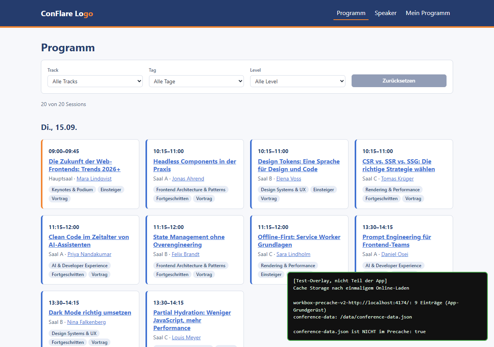
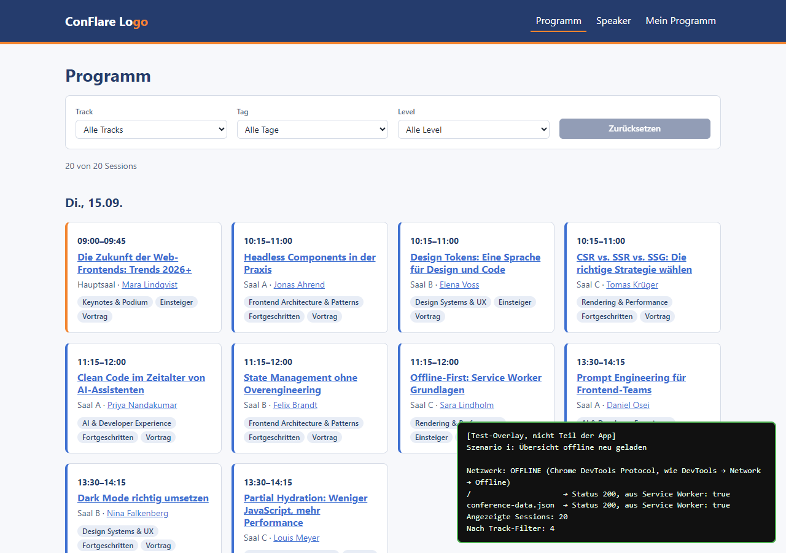
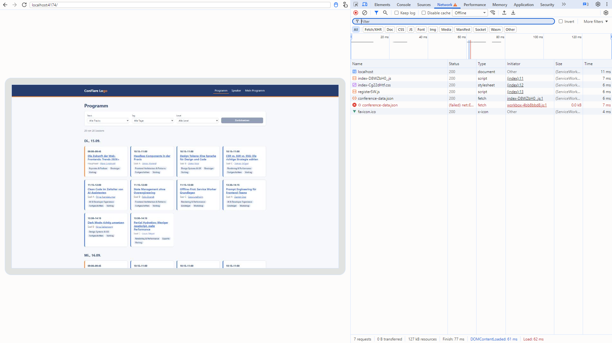
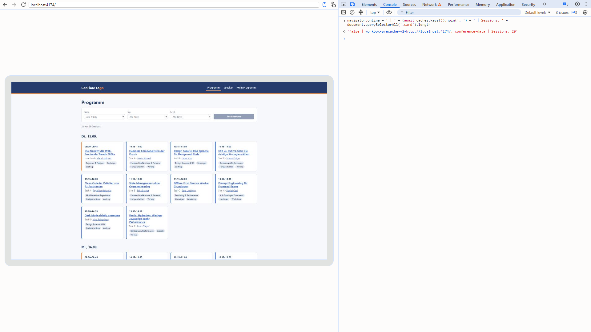
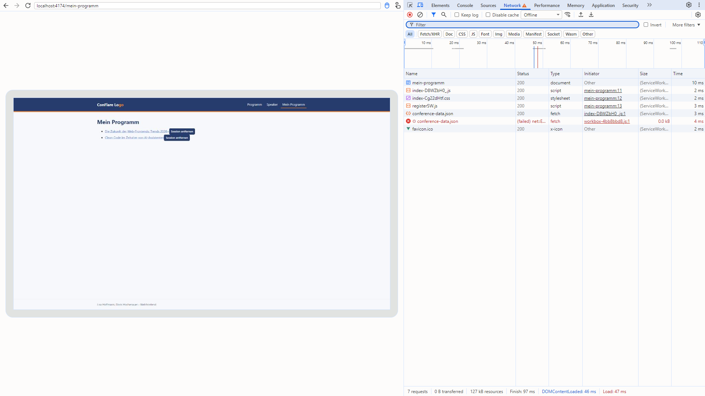
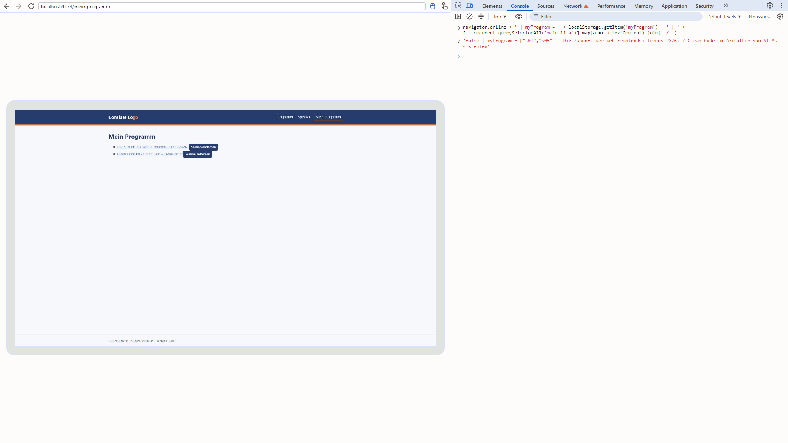
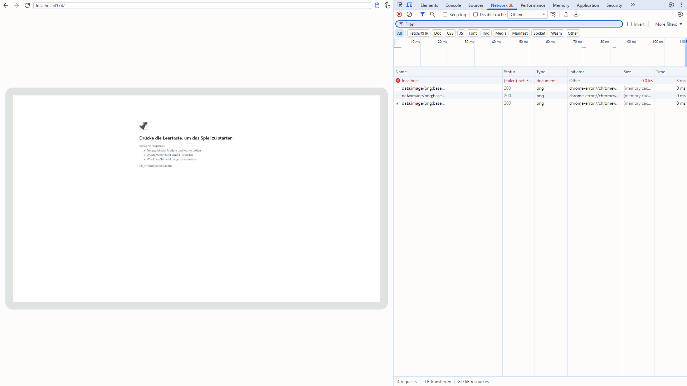

# Verifikations-Nachweis

## Vorgehen

- **Build:** `npm run build` + `vite preview` (Port 4174), da der Service Worker nur im Produktions-Build aktiv ist.
- **Browser:** Chrome 157 (headless), Windows 11.
- **Offline:** in den Chrome-DevTools über Network → „Offline" (Command-Menü „Go offline"), im ersten Testlauf über das DevTools-Protokoll (`setOfflineMode`).
- **Ablauf:** automatisiert mit Puppeteer, jedes Szenario in einem eigenen, leeren Browser-Kontext (wie Inkognito). Zwei Testläufe: App-Ansicht mit Messwerten ([`assets/offline-test.mjs`](assets/offline-test.mjs), Rohdaten [`assets/results.json`](assets/results.json)) und echte DevTools-Ansicht neben der App ([`assets/devtools-test.mjs`](assets/devtools-test.mjs)).
- **PWA-Audit:** Lighthouse 11.7.1 (letzte Version mit PWA-Kategorie), Report: [`assets/06-lighthouse-pwa-report.html`](assets/06-lighthouse-pwa-report.html).

Die grün umrandete Box in den Screenshots ist ein Test-Overlay mit den gemessenen Werten, nicht Teil der App.

## PWA-Grundlagen (Teil A)

Service Worker aktiv und steuert die Seite, Manifest mit Name, `display: standalone`, `start_url`, Farben aus den Tokens und Icons in 192 und 512 px.

Lighthouse: **Installable ✅**, Splash-Screen ✅, Theme-Color ✅, Viewport ✅, maskable Icon ❌.

## Szenario i: Session-Übersicht offline

Nach einmaligem Online-Laden liegen das App-Grundgerüst im Precache und die Programmdaten im Cache `conference-data`. Die JSON ist nicht im Precache (ADR-0006).

Offline neu geladen: `/` und `conference-data.json` kommen mit Status 200 aus dem Service Worker, alle 20 Sessions sichtbar, Track-Filter funktioniert (4 Sessions).

DevTools: Network auf „Offline", alle Dateien inklusive `conference-data.json` kommen „(ServiceWorker)", 0 B übertragen. Die rot markierte zweite `conference-data.json`-Anfrage (Initiator `workbox-…js`) ist der Hintergrund-Abgleich von Stale-While-Revalidate, der offline erwartungsgemäß scheitert, ohne die Anzeige zu stören.

DevTools-Konsole: `navigator.onLine` ist `false`, beide Caches vorhanden, 20 Sessions angezeigt.

## Szenario ii: „Mein Programm" offline

Online Sessions s01 und s05 gemerkt, dann offline `/mein-programm` direkt neu geladen. Die Seite kommt über den Navigation-Fallback aus dem Service Worker, beide Sessions werden angezeigt. Offline „Session entfernen" funktioniert ebenfalls (localStorage danach `["s05"]`).

DevTools: Das Dokument `mein-programm` kommt offline mit Status 200 „(ServiceWorker)" (Navigation-Fallback), in der Konsole stehen die gemerkten IDs aus dem localStorage und die angezeigten Titel.

## Szenario iii: Erstbesuch offline

Leerer Browser-Kontext, zuerst offline, dann App aufgerufen: Fehlerseite des Browsers (`ERR_INTERNET_DISCONNECTED`), kein Service Worker registriert.

DevTools: Das Dokument `localhost` scheitert mit `net::ERR_INTERNET_DISCONNECTED`, kein Eintrag „(ServiceWorker)", da noch keiner installiert ist.

## Einordnung

Getestet wurde der Produktions-Build in Chrome, offline simuliert über das DevTools-Protokoll, ergänzt durch ein Lighthouse-PWA-Audit. Die Ergebnisse bestätigen die Entscheidungen aus ADR-0006: Nach einem einzigen Online-Besuch sind App-Grundgerüst und Programmdaten gecacht, Startseite und „Mein Programm" funktionieren offline vollständig, auch beim direkten Neuladen einer Unterseite. Szenario iii zeigt erwartungsgemäß die Browser-Fehlerseite, da der Service Worker erst online installiert werden muss. Lighthouse bestätigt die Installierbarkeit. Die gemessenen Werte jedes Testlaufs sind zusätzlich in `results.json` festgehalten und damit nachprüfbar.

Lücken: Der Offline-Modus der DevTools entspricht nicht ganz echtem Flugmodus oder überlastetem Konferenz-WLAN, bei dem Anfragen lange hängen statt sofort zu scheitern. Getestet wurde nur in Chrome, nicht in Safari oder auf iOS. Die Aktualisierung per Stale-While-Revalidate bei einer späten Raumänderung wurde nicht geprüft, sichtbar ist nur der offline gescheiterte Hintergrund-Abgleich. Die App zeigt nicht an, dass sie offline ist oder veraltete Daten anzeigt. Lighthouse bemängelt außerdem ein fehlendes maskable Icon. Der Gegentest von Person 1 auf dem eigenen Rechner ergänzt diese Ergebnisse im Entscheidungsprotokoll.
